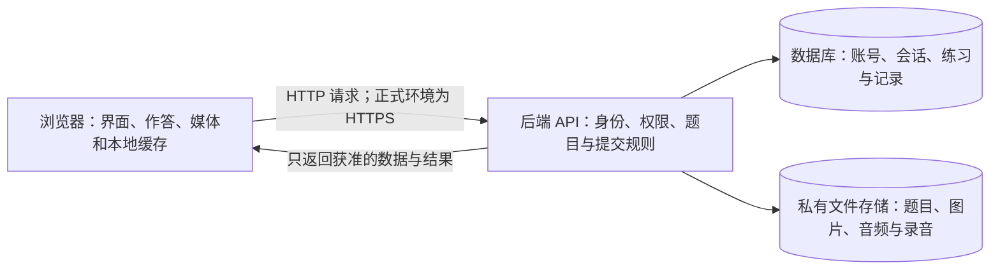

# 前后端、统一身份与题目分发方案

日期：2026-10-23。状态：结合当前源码的讨论稿。本轮修复 SAT 模块结束页并包装完整试卷；本文没有实现或启用正式登录、云端同步、加密分发或线上部署。后端目录和接口是建议，不能当作已可用功能。

## 1. 先理解当前本机程序

前端是浏览器里的程序：显示页面、渲染 Markdown/LaTeX、接受选项和填答、播放音频、录音、显示倒计时。后端是接收请求的服务程序：检查身份和权限、读写数据库、决定可下发哪些内容、保存作答并给出可信结果。

二者可以在同一台电脑，也可以由不同服务器承载。区分依据是运行位置与信任责任，不是文件是否放在同一个仓库。

本机现状是浏览器加 Python 服务。访问 `http://127.0.0.1:8888/` 时，浏览器先向 Python 请求首页，再请求 CSS/JS；前端运行后向 `/api/...` 取目录和题目。Python 不是浏览器插件，而是独立进程；关闭它会失去 API 和页面服务。`127.0.0.1` 指访问者自己的电脑，其他学生在自己的电脑访问这个地址不会连到维护者。



正式环境可以由一个域名提供 `/`、`/sat/`、`/toefl/` 和 `/api/`。页面文件与 API 可以同机部署，甚至由同一个进程服务。对外保持同源可减少跨域配置，但仍需每次检查权限。如果把后端安装在每位学生自己的电脑上，学生通常也控制该机器，不能将此程序当作可信的考试裁判。

## 2. 当前已实现与缺少什么

| 当前文件或行为 | 实际状态 | 正式接入所需变化 |
| --- | --- | --- |
| `scripts/serve_platform.py` | 本机静态文件、题库和备份 API；只监听回环地址 | 保留为开发工具；不要直接开放成生产登录服务器 |
| `/api/auth/session` | 固定测试 `admin`，返回 `authenticated: false` | 改为验证真正会话，不能凭前端显示的名字授权 |
| SAT `/api/sat-packs` | 将题干和 `solutions.json` 一起提供给浏览器 | 增加学生专用响应，考试前不含标准答案/解析 |
| SAT 判分与计时 | 浏览器判分；本机时间与存储驱动流程 | 正式模式由后端确认截止时间、模块状态及成绩 |
| IndexedDB/localStorage | 当前浏览器保存题目、作答和记录 | 作为缓存与断网队列，不能承担跨设备数据库或访问控制 |
| TOEFL `src/cloud/` | 已有账号、会话、同步、媒体、评分源码及替身测试 | 当前匿名服务未启动它；需接公共身份和正式资源，再单独验证 |

当前 Host/Origin 校验和本机写令牌用来限制开发服务的请求来源，不等于学生登录或管理员授权。模块结束页现在表示本机状态已保存，并不证明发生了网络上传。以后应让“提交中、提交成功、离线待同步”对应真实后端状态；网络失败不能显示已经上传成功。

## 3. 哪些文件继续属于前端

| 位置 | 建议保留的职责 |
| --- | --- |
| `apps/web/index.html`、`styles.css`、`app.js`、`home-model.js` | 公共首页、目标/报告界面、展示统计；统计原始记录改从当前账号的 API 获取 |
| `apps/web/sat-bridge.js`、`toefl-bridge.js` | 入口与过渡适配；逐渐接公共 API，不成为权限判断器 |
| `apps/sat/html/`、`css/`、`js/exam.js`、`content-renderer.js`、`math-tools.js`、`line-reader.js` 等 | 保留考试外观、题型交互、Markdown/LaTeX、工具和前端流程显示 |
| `apps/sat/js/storage.js` | 缓存和断网待同步队列；记录需按已验证账号隔离，退出时锁定私人缓存 |
| `apps/sat/js/sat-pack.js`、`sat-session.js` | 内容检查与练习辅助可留；正式判分规则要有后端实现，不能信任浏览器提交的分数 |
| `apps/sat/vendor/` | 可公开的渲染依赖、字体与许可 |
| `apps/toefl/src/frontend/` | 现有题型、导航、音频、录音和复盘界面 |
| TOEFL `bootstrap.js`、`cloud-client.js`、`accounts-client.js` | 虽在 `src/cloud/` 目录，实际运行于浏览器，属于前端客户端；需适配统一 API |

前端可以承担大多数可见业务交互，后端不必决定每个按钮如何绘制。但“谁能看、谁能改、是否过期、是否提交、正式得分是多少”应由后端核实。前端可以做即时输入校验和分数预览以提高体验；客户端预览不应自动成为服务器认可成绩。

建议新建共享的浏览器 API/会话/同步客户端，由两个考试分别适配，避免把统一登录逻辑复制到两个应用。无需为了前后端分离先换 React、重写考试界面或拆成三个仓库。

## 4. 优先新建哪些后端模块

建议先在同一仓库新增一个公共 API 服务。以下 `.mjs` 是便于复用现有 TOEFL JavaScript 的文件布局示意；具体选 Worker、普通 Node 或其他运行环境仍需另行确定，不同时建设两套认证服务，也不直接承诺任何免费服务足够。

```text
apps/api/
  src/app.mjs                      HTTP 路由入口、错误响应、请求编号
  src/auth/sessions.mjs            会话验证、过期、退出及撤销
  src/auth/accounts.mjs            邀请、角色、账号管理、登录保护
  src/content/student-view.mjs     过滤学生可见字段，不发答案解析
  src/content/assessments.mjs      SAT/TOEFL 独立试卷与内容版本
  src/content/distribution.mjs     按权限下发内容和媒体授权
  src/attempts/service.mjs         开始、保存、模块提交、结束与恢复
  src/grading/sat.mjs              服务端 SAT 判分，未审答案仍待审
  src/grading/toefl.mjs            TOEFL 客观题与评分任务适配
  src/records/sync.mjs             版本、幂等、冲突与取消标记
  src/records/profile.mjs          个人资料、目标和计划
  src/media/service.mjs            图片/音频访问与录音上传确认
  src/storage/                    数据库、私有文件与密钥接口
  migrations/                     可重复执行的数据库结构迁移
shared/contracts/                 身份与记录信封；题目内容仍各考试独立
tests/integration/                双账号隔离、越权、重试与跨设备检查
```

这些目录尚未创建。现有 `shared/question_schema.py` 和导入/打包脚本属于后端或维护工具，可保留；它们处理的完整题目可能含答案，不可直接当作学生响应。数据库迁移、SQL、服务端评分、媒体主密钥和账号管理实现不应作为浏览器静态文件发布。

TOEFL 的 `worker.mjs`、`account-features.mjs`、`draft-cancellation.mjs`、`assessment.mjs`、SQL 和对应测试可复用机制。它依赖 Worker 的 DB/ASSETS/AI bindings，不能直接当普通 Node 服务启动。应逐步提取公共会话与保存协议、保留来源和测试，而不是同时启用一套 TOEFL 登录和另一套学校登录。

## 5. 登录、用户管理与同步怎样工作

一个可理解的登录过程是：浏览器发送用户名与密码；后端查账号、验证密码后签发一个随机会话凭证；浏览器以后请求自己的题目或记录时携带凭证，后端据此确定用户。数据库保存的是带盐的密码哈希，不是明文密码或可逆加密密码。建议使用成熟认证组件/服务；若自建也应使用成熟密码哈希库，不把现有简化实现直接升级成正式认证。参考 [OWASP 密码存储建议](https://cheatsheetseries.owasp.org/cheatsheets/Password_Storage_Cheat_Sheet.html)。

对于同源网页，可采用由后端管理的随机会话与 `HttpOnly`、`Secure`、合适 `SameSite` 的 Cookie，配套 HTTPS、过期、撤销、跨站请求保护及请求权限检查；不要把长期管理员令牌写入前端代码或 localStorage。开发用 HTTP 与正式 HTTPS 的 Cookie 配置需分开，不得为了方便而降低线上要求。参考 [OWASP 会话管理](https://cheatsheetseries.owasp.org/cheatsheets/Session_Management_Cheat_Sheet.html)。

登录回答“你是谁”，权限回答“你能做什么”。每次读取或修改练习，都要由后端根据会话检查记录的拥有者；把请求里的 `userId` 改成别人不能获得别人记录，猜到题图或录音 ID 也不能绕过权限。管理员按钮隐藏不隐藏都不能决定权限。参考 [OWASP 授权建议](https://cheatsheetseries.owasp.org/cheatsheets/Authorization_Cheat_Sheet.html)。

TOEFL 已确认一个账号只保留一个有效登录会话，新浏览器成功登录会使旧会话失效；校园共用 IP 不作为身份。跨设备同步可支持换设备登录后恢复记录，不等于允许多个独立会话同时作答。这项政策应在公共身份层继续保留。

首批 API 可以围绕实际动作设计：

| 动作 | 建议接口 | 后端应决定的内容 |
| --- | --- | --- |
| 登录、退出、查询会话 | `POST /api/auth/login`、`POST /api/auth/logout`、`GET /api/session` | 身份、过期、撤销及角色 |
| 邀请与账号管理 | `/api/admin/users`、`/api/admin/invitations` | 管理权限、确认与审计；不能误删其他账号或共享题库 |
| 创建练习 | `POST /api/attempts` | 用户、试卷版本、模块顺序、考试模式与截止时间 |
| 保存作答 | `PATCH /api/attempts/{id}/answers` | 归属、模块是否开放、操作编号和记录版本 |
| 提交模块 | `POST /api/attempts/{id}/modules/{moduleId}/submit` | 幂等提交、锁定、判分、推进与休息时间 |
| 查看报告/解析 | `GET /api/attempts/{id}/report` | 只读自己的记录；按提交/复盘政策放行答案 |
| 保存个人目标/计划 | `/api/me/profile`、`/api/me/plan` | 从会话取用户，不接受客户端自行指定拥有者 |
| 上传录音 | `/api/attempts/{id}/recordings` | 归属、大小/类型、上传完成与摘要，再保存引用 |

前端先将尚未确认的作答放入本地队列，断网恢复后重试。每个操作带稳定 `clientMutationId` 和版本：同一操作重复发送只保存一次；版本已过期时明确返回冲突，再恢复或提示处理，不盲目覆盖。录音只有文件确认完整后才更新作答引用，保留现有取消标记以防旧设备把已取消练习复活。

初期可为同一练习限制一个有效写入设备，降低冲突复杂度。正式考试时间以服务端截止时间为准，浏览器倒计时只负责显示。断网时仍保存草稿，但是否接受晚到答案要有明确考试/练习规则，不能仅信任客户端声称的时间。

现有 `admin` 浏览器记录不能自动分给第一个登录学生；账号切换也不能沿用上一个账号的私人缓存。数据库先包含 users、sessions、invitations、assessments、attempts、module_submissions、answers、profiles、plans、recordings 与必要的同步/审计表；表结构及索引应根据最终后端形成可重复迁移。

## 6. 加密分发的能力与边界

需要区分三个不同目的：HTTPS 保护网络传输；私有存储和数据库权限保护服务器中的文件与个人记录；客户端解密让获准浏览器把密文变成可显示内容。它们不能互相替代。

可先采用较简单的方案：后端验证登录和试卷权限，从私有存储读取所需模块，再通过 HTTPS 下发学生可见的题干、选项和资源，不发完整题库或答案。现有 TOEFL Worker 是服务器使用 `CONTENT_KEY` 解密后再返回内容，浏览器仍能取得可见明文；当前统一匿名服务并未启用这条私有资源链路。

如果确有密文缓存或加密分发需求，可以设计版本化内容信封，包含算法版本、`keyId`、唯一 nonce/IV、密文和题目摘要，由服务器在核验权限后发放所需解密能力，浏览器使用成熟 Web Crypto API 解密并渲染。使用经过评审的认证加密方案，例如正确使用的 AES-GCM；主密钥只留在后端，不能在 JS 中写死全库密钥，不能对同一密钥复用 nonce。算法、信封格式和密钥生命周期需要专门评审；本轮没有实现它。参考 [MDN Web Crypto API](https://developer.mozilla.org/en-US/docs/Web/API/Web_Crypto_API)。

但只要合法用户能在浏览器看见题目，就可能保存响应、观察解密结果、复制文本或截图。不可导出密钥也不能阻止使用该密钥解密后读取明文。前端解密不能提供“题目永远无法导出”的承诺；把全部密文和万能密钥一起下载尤其没有意义。

优先保证每次访问鉴权、按需下发当前允许模块、提交前不发答案、资源短期授权、合理限速和访问记录。短期链接仍需正确的签名/权限与私有缓存配置；不能把题库放进公开 GitHub 或 Pages 文件目录，再以隐藏链接充当权限。浏览器退出后可清理缓存，但无法收回用户已经复制的内容。

## 7. 能否使用 GitHub 托管

GitHub 仓库用于源码版本、分支、PR 与检查；前后端源码可以放在同一个仓库。真实题库、题图音频、密码、会话、密钥、数据库和用户记录不放 Git。公开后端源码本身不应导致用户获得秘密，秘密应由部署环境或私有存储提供。

GitHub Pages 发布静态 HTML/CSS/JS，不能替代正在运行的 Python/Node/Worker API、数据库或私有文件服务。前端静态演示可以放 Pages；真实登录和个人记录仍需另外的后端。GitHub 官方还提示 Pages 不适合密码等敏感交易，因此不建议把这套学校账号平台的正式登录站点建立在 Pages 上。私有仓库的 Pages 可用性还与套餐有关；源码私有不自动代表部署网站只有团队能访问。参考 [GitHub Pages 说明](https://docs.github.com/en/pages/getting-started-with-github-pages/what-is-github-pages) 与 [使用限制](https://docs.github.com/en/pages/getting-started-with-github-pages/github-pages-limits)。

当前程序也不能把 `apps/web/` 直接上传 Pages 就完整运行：Python 负责 `/sat/`、`/toefl/` 路由、桥接脚本注入、题库 API 和匿名构建检查；这些不会自动出现在静态托管中。项目型 Pages 默认还有仓库子路径，当前 `/sat/` 等根路径需改为正确部署基址。即使只部署公开演示，也需要明确的静态导出流程。

更适合的正式结构是同一域名提供静态前端与 `/api/`，后面连接公共身份、数据库和私有文件存储。可评估支持静态页面加函数/API 的托管平台，也可使用受管理服务器；若复用 TOEFL Worker，可评估其运行环境与数据库兼容性。这里只提出结构，不选购、不部署、不配置 DNS。旧部署文档的免费额度不作为当前承诺，选型时再核对。

## 8. 建议实施顺序

1. 固定公共身份/记录契约与学生可见字段；两个考试继续使用独立题目结构，保留已确认界面。
2. 用匿名数据建立公共 API、成熟认证、邀请和角色；验证两个账号不能互读、不能越权，退出与换设备恢复正确。
3. 将目标、计划、记录、作答和录音逐步接入；实现幂等、版本冲突、断网队列与取消标记，不自动导入原 `admin` 历史。
4. 拆分题干与答案响应，接后端判分、权威时间和真实模块提交；未审答案继续显式待审。
5. 在稳定鉴权和分发之后再决定是否需要客户端加密及其密钥方案。
6. 用 150 名总用户对应的实际并发模型验证集中登录、音频起播、保存和录音上传，再进行受控部署。总用户数不能直接推导同时在线量、费用或容量。

每步先做本机或测试环境验收，再迁移下一步；无需一次重写整个应用，也不把“源码已经包含”写成“功能已上线”。
