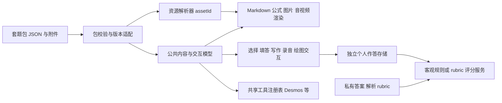

# 所有题目包结构策略

状态：2026-10-22 历史设计草案，保留作调研与方案比较，不是当前实现合同。

当前项目按考试及题目类型分别设计、保存题目包，不再要求跨考试统一题目模型。SAT 以 [专用题目包协议](drafts/sat-question-packs/README.md) 为准，已接入读写/数学显示与 SPR 判分；TOEFL 现行合同见 [题型格式](toefl/QUESTION_FORMAT.md)。以下公共模型、工具注册表和实施顺序保留为当时提议；正文“当前”“本次”“本轮”和功能缺项均指 2026-10-22 快照，不表示现行项目状态。

本次只提供结构、原创样包和实现建议；没有启用新导入器、Markdown/媒体渲染器、Desmos 服务、自适应引擎或云端评分。原 SAT 的 HTML、JavaScript、CSS 和考试行为保持原样。

## 1. 建议团队确认的结论

采用“**完整套题包 + 平台统一渲染/工具层 + 考试专用交互与判分器**”。

- 套题包带有试卷结构、题组/小问、答案与解析、资源清单和附件；不能只有一组单选题 JSON。
- SAT、AP、TOEFL 使用相同外层约定，但根据科目、年份与考试版本使用不同 profile。题型和交互不能都压成四选一。
- Markdown、数学公式、图片、音频、视频、录音控件等由平台公共层加载与渲染。题包只保存内容和声明式配置，不携带网站程序。
- Desmos 在平台统一通过官方 API 加载，或在获得合作授权后自托管。**每个题包都不包含完整 Desmos 引擎、SDK 或 API key。**
- 标准答案、参考答案、评分表和解析是题目内容；学生答案、录音、用时、批改、AI 估分和错题状态另存个人作答记录。
- 先评审本草案，再实施新的 v2 导入/渲染协议。现有 v1 与旧 SAT 引擎继续保留，通过适配器兼容，不能直接替换后声称已支持全部考试。

本文件和各样包描述的是本平台拟定的存储协议。College Board 与 ETS 发布的考试说明不是一个现成的跨考试 JSON 标准。

本轮具体草拟 SAT 数学、AP 和新版 TOEFL；已有 SAT 阅读与文法保留旧格式适配。Personal Vocab 后续可沿用资源与交互层另定 profile，本轮不宣称已完成词汇题包规范。

## 2. 当前项目格式能覆盖多少

当时检查了 [v1 格式文档](question-format.md)、[v1 JSON Schema](../back-end/shared/question-set.schema.json)、[规范化程序](../back-end/shared/question_schema.py)、SAT 原导入器及本地 `origin/toefl` 的 `9d08f56` 源码快照。后者当时是独立分支中的实际源码，尚未与 main 的题目协议统一；该次调研未将该分支合并进来。链接已随目录迁移更新，下表仍保留当时的能力评估。

| 能力 | 当前 main 的 v1 | 完整套题包需要 |
| --- | --- | --- |
| 题集身份、考试命名空间、题目顺序 | 有 | 增加不可变修订号、考试版本、文件摘要与出处 |
| SAT 阅读与文法四选一 | 已支持 | 保留适配 |
| 普通图片/图表/表格 | 单个 visualStimulus；chart 也是图片表示 | 有序、可组合、可共享的多种材料及资源清单 |
| 正确答案 | 每题一个 correctOption | 单选、多选、数值规则、填空映射、词块顺序或 rubric |
| 解析 | 字符串，可为空 | 必备解析状态、公式/步骤/图文、选项反馈与编校来源 |
| SAT 数学 SPR 填答 | 不支持；SAT section 被限定为 Reading and Writing | 数值输入格式与数学答案判定分别建模 |
| Markdown、完整数学公式 | 只保留部分文本样式，非完整 Markdown/LaTeX 引擎 | 统一 Markdown 与数学内容块渲染 |
| 音频、视频、口语录音 | v1 无通用字段/响应类型 | 媒体资源、播放阶段、采集要求与时序 |
| 内嵌 Desmos | 不支持 | 公共工具注册表、考试分区规则、可选作者图状态 |
| AP 多小问/过程分/作品集 | 不支持 | 任务、Part、交互、rubric、作品提交要求 |
| 共享材料、多阶段/自适应 | 模块题量和时长，缺正式路由协议 | section/module/stage、路由与导航策略 |
| 完整可携带套题包 | JSON 与图片分放，缺完整包清单 | 文件清单、附件校验、完整性与能力检查 |

已用原创合成题做只读探针：直接给 canonical 题目加 `audio`、`interactive` 或 `correctOptions`，严格校验会报未知字段；交给旧规范化函数则会丢弃未允许字段。将 SAT section 改为 Math 也会拒绝。因此，**不能只在旧 JSON 中增加字段便认为信息已被保留或功能已实现**。

TOEFL 独立分支已含 12 类任务、共用材料、音频、transcript、填词和组句等旧结构；其适配器目前保留 `payload`，并不是完整 v2 协议。已选答案、实际录音、ASR、AI 估分与完成状态不得一起搬入题目包。匿名 fixture 的计时值是测试值，也不是官方考试时限。

## 3. 一个完整套题包的物理结构

```text
exam-pack/
  pack.json                  # 身份、文件位置、资源清单、工具依赖
  assessment.json            # 试卷结构、版本、时限、模块与选择/路由规则
  items.json                 # 共享材料、题目、大题/小问、交互
  solutions.json             # 答案、参考答案、rubric、解析（出题端私有）
  assets/
    images/
    audio/
    video/
    documents/
    graphs/                  # 可选：作者导出的图状态；不是 Desmos 程序
    notation/                # 可选：MusicXML/乐谱图
```

可以把此目录压缩为 ZIP 交换。平台导入后，把 JSON 与附件分别放入题库和资源存储，再按 `assetId` 解析；运行时不要反复从 ZIP 直接播放大音频。正式包应能从清单判断附件是否齐全；引用资源缺失的包不能显示“完整模考可用”。

为支持跨套题共享题目，稳定 `itemId` 和 `revision` 应独立于题包内的显示序号。一个包可以复制其需要的材料和资源，或在平台内部按摘要去重；离线导出必须带齐实际依赖。原始 authoring 包的修订保持不可变，个人作答关联该修订与附件摘要，不能被后续改题悄悄覆盖。

`pack.json` 示例（仅示意，完整样包见后文）：

```json
{
  "schemaVersion": "2.0-draft",
  "documentType": "exam-pack",
  "status": "draft",
  "id": "sat:math:synthetic-paper",
  "revision": "1",
  "title": "原创 SAT 数学结构样包",
  "language": "en",
  "exam": "sat",
  "subject": "math",
  "examVersion": "digital-sat-framework-2026-09",
  "administrationYear": 2026,
  "effectiveFrom": null,
  "files": {
    "assessment": "assessment.json",
    "items": "items.json",
    "solutions": "solutions.json"
  },
  "assets": [
    {
      "id": "figure-1",
      "kind": "image",
      "mediaType": "image/svg+xml",
      "path": "assets/images/figure-1.svg",
      "status": "placeholder",
      "sha256": null
    }
  ],
  "toolRequirements": [
    {
      "id": "exam-calculator",
      "provider": "desmos",
      "kind": "graphing-calculator",
      "runtimeRegistryKey": "desmos.shared",
      "configuration": {"profileId": "sat-math-2026", "initialState": "blank"},
      "verificationStatus": "requires-validation"
    }
  ]
}
```

### 3.1 公共必需信息

| 层级 | 需要保存的信息 |
| --- | --- |
| 套题 | ID、修订、考试/科目/语言/年份、规则版本、名称、文件位置、资源摘要、来源与授权、所需平台能力 |
| 试卷 | section/module/stage 顺序、时限、题目引用、共享材料组、选做规则、模块锁定、返回策略、工具规则、路由与计分配置 |
| 材料 | 有序文字/Markdown/公式/表格/图片/音频/视频/代码/文献；多题共享材料 ID；出处、说话人、段落与时间锚点 |
| 题目 | 稳定 ID 与修订、题型、知识点/技能/难度、材料引用、题干、Part、小问标签、展示与交互配置 |
| 响应声明 | 选项、数值、填空、词块、长文本、代码、录音、绘图或附件的输入约束；只定义要求，不存实际学生内容 |
| 解答 | 标准答案或多个可接受答案；开放题参考答案/必答要点；评分细则、分值、步骤解析、错误选项解释与编校状态 |
| 附件 | assetId、类型、MIME、相对路径、sha256、文件大小、时长/尺寸/语言、版权来源；字幕/原文的投递权限 |

细节约定见 [公共字段合同](drafts/exam-packs-v2/CONTRACT.md)。每个可评分 Part 均关联一个 `solutionId`，因此选择题、大题中的每个小问、口语的每个响应都能找到解答和解析。

### 3.2 内容块和交互分开

**内容块负责显示**：text、Markdown、math、image、audio、video、table、code、structured-document、music-notation、interactive 等。选项与解析也复用这些内容块。

**交互负责收答案**：single-choice、multiple-choice、numeric-entry、text-entry、gap-fill、token-order、extended-text、audio-recording、drawing、file-upload、code-entry、music-entry 等。不要用 HTML 片段代替类型定义。

例如同一道 AP FRQ 可以共用一张图，在 (a) 小问填数值，在 (b) 小问输入公式与过程，在 (c) 小问上传手写图；每小问有各自评分点。TOEFL 的一个音频可被多道选择题共用，原文只在复盘投递中提供。

Markdown 推荐作为文字的出题格式；复杂交互仍用 JSON。可采用 `{type:"text",format:"markdown",text:"..."}`，不要求在 Markdown 中嵌套任意 iframe、脚本或媒体播放器。题目中的 Markdown 图片链接可用 `asset:figure-1` 这样的受控引用，由平台解析，不能任意下载外部链接来补齐正式考试资源。

## 4. 各考试的具体要求

### 4.1 SAT 数学

以 College Board 2026 年 9 月数字 SAT 框架为调研依据；不要把框架发布日期冒充所有规则的独立生效日。正式 SAT 数学为两个 35 分钟模块、共 44 题，包含四选一与 Student-Produced Response（SPR）。训练题包仍可使用较少题目。[框架 v4](https://satsuite.collegeboard.org/media/pdf/assessment-framework-for-digital-sat-suite.pdf)、[考试结构](https://satsuite.collegeboard.org/sat/whats-on-the-test/structure)

需要补充：

- 文字、LaTeX、几何图、数据表和函数图的混排；知识域与技能标签。
- SPR 的输入字面限制、分数/小数解析、负数和多个数学可接受值；学生只需输入一个答案。
- 正数最多 5 字符、负数含负号最多 6 字符等规则放在版本化输入 profile 中。不能随意用全局浮点 tolerance 判定所有题。官方 `2/3` 示例接受若干足够精度的小数字面形式，短写成 `.67` 等并不合格。[学生填答说明](https://satsuite.collegeboard.org/sat/whats-on-the-test/math/student-produced)、框架附录 D 第 205 页
- 数学部分的空白计算器是考试工具；题干中的作者预设互动图是另一种用途。不能给正式模考计算器预填解题表达式。
- 自适应模块、预试题标记和量尺分需要另外的试卷/计分服务，不能凭题目答案率自行重建官方算法。

样包：[SAT Math](drafts/exam-packs-v2/sat-math/README.md)。其原创题只演示结构，不是 44 题完整试卷。

### 4.2 AP

AP 必须按 `courseId + administrationYear + frameworkVersion` 区分。官网在调研时已列出部分 2027 年调整，因此不能把 2026 的所有规则永久写死。数学、理科、人文、外语、音乐、计算机和作品集的交互与评分不同。[官方考试模式](https://apcentral.collegeboard.org/exam-administration-ordering-scores/administering-exams/digital-ap-exams/exam-modes)

| 家族 | 必须表达的信息 |
| --- | --- |
| 单选、多选 | 可变选项数、稳定选项 ID、需选择的数量与答案集合；AP CSP 有 select-2 |
| 材料题组 | 多文献/图片/地图/数据/代码/音频共用材料，题序与出处 |
| 理工 FRQ | 多小问、公式/单位/精度、计算过程、方法分、评分点依赖/例外和跨小问规则 |
| SAQ/DBQ/LEQ/作文 | 文献元信息、材料引用、阅读与作答时间、选做规则、参考文本与 rubric |
| 绘图、手写、乐谱 | 画布/坐标模板或附件要求；人工评分与参考图，不需要恢复已经取消的 OCR |
| 外语和音乐 | 音频/乐谱、播放规则、准备与录音阶段、逐轮作答、口语/视唱评分表 |
| 编程 | 给定代码、代码输入、语言/参考资料版本与 rubric；显示代码不等于允许题包执行脚本 |
| CSP/Capstone/Art | 跨课时项目、PPR、作品要求、引用、展示/答辩阶段和作品集评分 |
| 新科目 | 如 2027 Cybersecurity 的日志/权限/防火墙/设备政策多证据材料；允许版本化扩展 |

计算器并不是 AP 全局开关。例如 Calculus/Precalculus 按指定部分启用；其他科目可能使用科学或四则计算器。具体许可取自科目/年份/分区 profile，不能为所有理科统一开放完整图形计算器。[官方计算器政策](https://apcentral.collegeboard.org/exam-administration-ordering-scores/administering-exams/exam-policies/calculator-policy)

AP 草稿是**多个科目结构的展示目录**；实际一套题必须选定一个科目/年份，不能把微积分、历史和外语混成同一官方 AP 卷。样稿见 [AP](drafts/exam-packs-v2/ap/README.md)。覆盖的是已核对的主要评估家族；正式上线前仍需逐科逐年验收。

### 4.3 新 TOEFL iBT

本轮按 **2026-01-21 后的新版 iBT** 建模，不把旧 integrated writing 或旧四道口语任务混入该 profile。新的 Reading/Listening 为自适应，Writing/Speaking 为线性流程。[ETS 当前考试结构](https://www.ets.org/toefl/test-takers/ibt/about/content.html?version=after-jan-2026)、[2026 规格](https://www.ets.org/pdfs/toefl/toefl-ibt-test-specifications-2026.pdf)

| 科目 | 任务 | 格式关键点 |
| --- | --- | --- |
| Reading | Complete the Words | 稳定 blankId、显示前缀/缺字长度、多个空位、标准缺字与整词、解析 |
| Reading | Read in Daily Life | 邮件/通知/帖子等结构材料、图像与共享小题 |
| Reading | Read an Academic Passage | 共用文章、段落/插入位置锚点、小题与证据 |
| Listening | Listen and Choose a Response | 音频提示、选项、答案、复盘原文 |
| Listening | Conversation / Announcement / Academic Talk | 共用音频、说话人/时间锚点、题组和复盘原文 |
| Writing | Build a Sentence | 词块唯一 ID、固定片段、slotId、干扰词、可接受的词块顺序 |
| Writing | Write an Email | 情境、收件人/主题、交际要求、参考答案与 rubric |
| Writing | Academic Discussion | 教授问题、参与者帖子、回答要求、参考答案与 rubric |
| Speaking | Listen and Repeat | 场景/提示音视频、每句原句、逐句录音时限与评分表 |
| Speaking | Take an Interview | 场景与预录采访者、四问顺序、逐问录音与参考回答/rubric |

口语复述与访谈都需要真正的音频证据；不能仅靠 ASR 文字相似度声称判断了发音、停顿和韵律。写作和访谈没有唯一正确字符串。参考答复/评分细则属于题目解答，实际录音与估分属于 attempt。

官方题数、基准时间和各阶段时限应保留来源与核验状态。自适应导致的路径差异不能用一组固定题量冒充；本地练习原始分也不等于 ETS 1–6 成绩。[Teacher FAQ](https://www.ets.org/content/dam/ets-org/pdfs/toefl/teacher-faq.pdf)、[考试概述](https://www.ets.org/content/dam/ets-org/pdfs/toefl/toefl-ibt-test-overview.pdf)

样包覆盖全部 12 类任务，但媒体仍有占位，见 [TOEFL 2026](drafts/exam-packs-v2/toefl-2026/README.md)。这不代表这些功能已接入首页。

## 5. 渲染与运行模块如何实现

以下是拟议模块边界，不是已创建的程序目录：



### 5.1 公共渲染层的建议选型

| 能力 | 第一阶段建议 | 原因/边界 |
| --- | --- | --- |
| Markdown | markdown-it，固定版本，平台统一部署 | MIT；支持受控扩展，原生 HTML 默认关闭 |
| 数学显示 | KaTeX，固定版本与字体 | MIT；快、可本地部署；公式渲染不负责判答案 |
| HTML 清理 | DOMPurify | Apache-2.0 或 MPL-2.0 双许可；用于受控的 HTML/MathML/SVG 清理 |
| 普通图片 | 原生 img/figure + 明确尺寸/alt/图注 | SVG 也按受控资源处理，图片题无需为每张图引入图库 |
| 表格/代码/文献 | 公共内容块组件 | 单位、引用锚点、代码语言和空白都保留 |
| 音频/视频 | 原生 audio/video，加平台播放控制器 | 套题规则决定播放次数、拖动、倍速、字幕与阶段 |
| 口语采集 | getUserMedia + MediaRecorder | 采集是响应控件，不是内容播放器；需安全上下文（正式站 HTTPS，本机 localhost/127.0.0.1 可例外）、权限及 MIME 支持检测 |
| 大文档/乐谱 | 先图片/下载；确需交互再独立引入 PDF/MusicXML 模块 | 不为普通题包捆绑大型查看器；MusicXML 可评估 OSMD（BSD-3-Clause） |
| 图形/科学计算器 | Desmos 统一适配器 | 工具许可与具体考试配置另外核验，见第 6 节 |

依据：[markdown-it 许可](https://github.com/markdown-it/markdown-it/blob/master/LICENSE)与[安全说明](https://github.com/markdown-it/markdown-it/blob/master/docs/safety.md)、[KaTeX 安全选项](https://katex.org/docs/security.html)、[DOMPurify](https://github.com/cure53/DOMPurify)、[MediaRecorder](https://developer.mozilla.org/en-US/docs/Web/API/MediaRecorder)、[OSMD](https://github.com/opensheetmusicdisplay/opensheetmusicdisplay)。

推荐把这些允许自托管的开源依赖及字体随网站固定版本部署一次，保留许可证，不要求学生临时访问公共 CDN；不把依赖重新复制到每个题包。是否新增构建工具应在实施时单独决定，当前原生页面架构并不要求立即更换框架。

### 5.2 Markdown 与公式流水线

先按块解析 Markdown/数学，再渲染与清理；代码块、链接、货币符号和公式定界符不能靠全局正则互相替换。KaTeX 保持 `trust:false`，限制宏展开和输出尺寸；清理器要有明确支持 KaTeX MathML/SVG 的允许列表，不能清理后又把未经审查的 HTML 拼回去。

新引擎的高亮/批注应关联题目修订、内容块 ID 与文本位置。现有 SAT 的 UTF-16 passageFormatting 不能未经转换就套在新 Markdown 源码或生成后的 HTML 上。此次不改旧 SAT 的阅读/高亮实现。

### 5.3 图片、音频与录音的实际行为

- `assetId` 通过资源解析器变为平台受控地址；限制文件类型/路径与大小，提供加载失败状态。音频文件名不是资源存在的证明。
- 小型图片按实际尺寸预留空间；当前题目与即将播放的音频提前准备，大附件按需加载。正式模考开始前检查必需资源，避免运行中才发现音频缺失。
- 播放计次要基于实际播放事件，未缓冲/被自动播放政策阻止时不能扣除次数。浏览器要求用户手势时，由“开始考试/设备检查”完成解锁。[MDN 自动播放规则](https://developer.mozilla.org/en-US/docs/Web/Media/Guides/Autoplay)
- 播放顺序、是否可暂停/快进、重复播放次数与录音倒计时按 stage 配置。单纯隐藏原生 controls 不能当正式考试的权限或防作弊机制。
- 录音先检测权限、设备、支持的 MIME 与真实输入音量；不同浏览器可能产生不同编码，后端可再统一转码。考试版本配置不应误把某个浏览器编码说成官方 TOEFL 格式。
- 播放进度、已消耗播放次数、当前 stage、未上传录音都属于可恢复 attempt；题包原文件保持只读。

## 6. Desmos：官方 API 优先，授权自托管次之，开源替代作为独立方案

### 6.1 已查明的许可和接口情况

**公开 API 不等于完整引擎开源。** 这次没有找到能按通用开源许可自由部署完整 Desmos 计算器的公开引擎发行版；不能因为示例代码或周边项目开放就推断引擎也可任意复制。

官方当前 v1.12 文档提供 JavaScript 嵌入 API、自己的 API key 申请入口、图状态保存/恢复，并明确提供合作伙伴自托管选项；授权自托管可支持离线。采用哪种授权、费用、域名/功能限制和交付方式，尚未向 Desmos 申请或获得确认，不能写成已获免费许可。[官方 API 文档（含 Self-hosting the API）](https://www.desmos.com/api/v1.12/docs/index.html)、[申请入口](https://www.desmos.com/my-api)

| 路线 | 包/平台分别负责什么 | 建议 |
| --- | --- | --- |
| 官方托管 API | 平台一次加载受许可 SDK 和配置；包声明工具需求 | 优先做小范围验证，确认授权与学校网络可达性 |
| 官方授权自托管 | SDK 构建由平台统一部署；包仍只保存需求/图状态 | 对离线、可用性要求高时向官方核实合作条件 |
| 直接复制官方网页/JS | 不存在“每包自动取得部署权”的前提 | 不作为实现路线 |
| 开源图形库或复刻 | 平台独立实现或接入另一套计算器 | 作为明确标注的练习替代，不宣称等同官方 Desmos |

这里的 API 主要是浏览器 JavaScript SDK，不是把每次函数计算发送到我们服务器的 REST 接口。API key 从平台部署配置读取；浏览器 SDK key 按官方设计可能出现在请求 URL 中，不把它误称为永不进入浏览器的服务器密钥。域名/授权限制按官方账户配置。

### 6.2 平台统一工具接口

建议将工具封装为一致接口，例如：

```text
ToolRegistry.ensureRuntime(runtimeRegistryKey)
ToolAdapter.mount(container, profile, optionalAuthorState)
ToolAdapter.getState()
ToolAdapter.setState(state)
ToolAdapter.resize()
ToolAdapter.destroy()
```

公共注册表负责 `provider`、SDK 的稳定版本、`hostingMode`（official-hosted / authorized-self-hosted）、允许的图形/科学/四则模式、功能配置、资源地址和许可信息。SDK 只加载一次，可以按可见题目或独立工具面板创建/销毁实例，不要每一页同时创建数十个计算器。

题包有两类声明：

1. **工具需求**：如 SAT 数学模块允许学生打开空白计算器；AP 某个分区禁用、允许或要求指定模式。
2. **作者材料**：教学题中的互动图。只携带通过官方 API 导出的作者初始图状态及静态替代图；不得把 Desmos 程序复制进包，也不得从旧个人演算状态迁入题干。

普通 API 计算器和官方考试专用计算器的配置可能不同，需记录核验状态；不能仅凭界面相似就声称复现 Bluebook。因网络或 SDK 不可用而切换替代工具时，应记录降级状态；如果该题/分区必须依赖交互工具，应暂停开始或告知不可用，不能静默按原模考条件计分。[Desmos 考试计算器说明](https://help.desmos.com/hc/en-us/articles/18228147914381-Practice-With-Testing-Calculators)

### 6.3 已找到的开源替代与第三方复刻

| 候选 | 已核对的公开情况 | 可考虑用途及未验证项 |
| --- | --- | --- |
| JSXGraph + math.js | JSXGraph 双许可 LGPL/MIT；math.js Apache-2.0 | 可自托管交互图与表达式计算；需要自行组合 UI、语法、键盘和考试限制，不能直接读取全部 Desmos state |
| GeoGebra | 当前官方源代码许可 EUPL 1.2；完整产品材料、语言文件/服务另有非商业/商业条款 | 功能丰富，但不能一概当成 MIT 式可任意商用部署组件；具体部署包与用途需确认 |
| Ambavia | Desmos 再实现；MIT；Rust、winit、wgpu 桌面程序 | 无现成浏览器嵌入交付；尚不支持不等式等功能，只适合作为解析/绘图研究参考 |
| Complexmos | MIT，浏览器 WebGL 应用，强调复数；依赖 MathQuill 等 | 可隔离验证；未发现成熟嵌入构造 API，也未证明 Desmos state 或官方考试工具兼容 |

来源：[JSXGraph](https://github.com/jsxgraph/jsxgraph)、[math.js 许可](https://mathjs.org/download.html)与[表达式执行边界](https://mathjs.org/docs/expressions/security.html)、[GeoGebra 当前许可](https://www.geogebra.org/license)、[Ambavia](https://github.com/fadaaszhi/ambavia)及[MIT 许可](https://github.com/fadaaszhi/ambavia/blob/main/LICENSE)、[Complexmos](https://github.com/sam-lb/complexmos)。本轮仅检查公开文档/源码说明，没有克隆、安装或运行第三方复刻，没有做数值一致性或官方题型回归测试。

如果要走完全开源路线，建议先用 JSXGraph + math.js 做独立练习工具原型，再拿一组自编函数/统计/不等式/单位/数值边界用例验收；不要为了表面相似直接采用未核验的网页复刻。表达式求值须限制能力、计算时间和内存，不运行题包提供的任意 JavaScript。

## 7. 答案、解析、评分与个人数据

- 客观题支持答案集合、多个可接受数值、逐空答案映射、可接受 token 排列等；输入格式合法性和答案正确性分别判断。
- AP 过程分与开放 TOEFL 回答使用 rubric。每个评分点保留分值、证据、依赖/例外、参考回答及解释；不得用一个正确字符串替代开放题评分。
- `status` 区分已审校答案与待审校内容。AI 建议/置信度不能自动成为标准答案；保留来源与人工编校过程的受控记录。
- 套题原始分、练习估分与正式量尺分分开。未获相应官方校准与评分服务时，不输出冒充正式 SAT/AP/TOEFL 成绩的换算。
- 作者完整包可以包含私有 `solutions.json` 和复盘材料；正式学生投递由服务端剥离答案、未开放解析/原文等。加一个 visibility 标签或 CSS 隐藏本身不构成访问控制。当前旧 SAT 本机客户端判分行为暂不调整。
- 作答数据库另存 attemptId、题包/题目修订、interactionId、实际答案或私有附件引用、时序、播放状态、评分与反馈。不把录音、学生作品、错题状态重新导出到公共题包。

## 8. 导入和兼容的实施顺序

1. **确认合同**：团队先确定包目录、ID/修订、内容块、交互、解答与 profile 的最小字段；补成严格 JSON Schema 和对应语义校验。当前样包只是草案，不能替代正式协议验收。
2. **实现包校验器**：校验文件清单、摘要、引用、题量/时长/小问分值、路径/类型/大小、ZIP 越界和解压总量；识别占位与缺失资源；遇到不支持的能力明确拒绝。
3. **实现通用内容渲染**：先 Markdown、公式、图片、表格及音视频，附原创资源样包。只用于新模块，不改原 SAT 界面。
4. **接入 SAT Math**：选择与 SPR 输入/判分、Desmos 公共适配器、版本化工具策略。先训练模式，再验证完整模考流程。
5. **映射新版 TOEFL**：将现有分支 record/items/audio 字段映射为共享材料与任务，补齐录音、token/slot、rubric 和恢复逻辑。原前端通过适配保持行为，不宣称已有真正官方自适应评分。
6. **AP 按科目接入**：先选一个已确认的科目和年份，验证单选/多选/FRQ，再逐步增加音频口语、绘图、代码与项目；每个 profile 独立验收。
7. **身份与正式投递**：启用账号、私有资源授权和服务端评分后，再验收多账号隔离与正式模考；不能把当前本机练习环境直接当生产考试平台。

该顺序是实施建议。本次草案没有安装依赖、获取 API key、签订许可、修改线上配置或发布服务。

## 9. 配套样包与验收边界

- [公共字段合同](drafts/exam-packs-v2/CONTRACT.md)
- [SAT Math 结构样包](drafts/exam-packs-v2/sat-math/README.md)
- [AP 科目结构展示](drafts/exam-packs-v2/ap/README.md)
- [新 TOEFL 12 类任务样包](drafts/exam-packs-v2/toefl-2026/README.md)

只把原创文字/题目/示意 SVG 与结构占位写入 Git；不上传本机真实题库、官方题目/音视频附件、学生信息或记录。`placeholder` 媒体尚未提供，包内也可能有只解释缺失原因的占位文件；这些文件都不等于可播放资源或可恢复的 Desmos 状态。只有题目/答案/资源结构完整且渲染器支持时，才可称为可运行套题。

本轮检查针对 JSON 语法、跨文件引用、答案/解析关联及已包含附件的路径/摘要；不代表完成媒体播放、Desmos 接入、考试还原或评分效果测试。示例包没有作为当前 v1 的输入，也未影响旧 SAT 的任何界面文件。

复核命令（Python 标准库，无需安装依赖）：

```sh
python3 docs/drafts/exam-packs-v2/validate_drafts.py
```

本轮结果：三个样包共 39 个题目/项目结构、74 个可评分 Part，均关联解答与解析；5 张原创 SVG 的路径与 SHA-256 一致；27 项资源被明确标为占位。它们不是三套已经可运行的完整官方试卷。校验脚本只服务这批草案，不代替正式 JSON Schema、任意 ZIP 导入安全检查或考试规则验收。

## 10. 请审阅者重点确认

- 是否同意“五个层面：清单、试卷、题目、解答、附件”的题包边界与共享工具层？
- 公共内容块/交互是否遗漏某个准备接入的科目或任务？AP 第一批具体做哪个科目/年份？
- Desmos 先采用官方托管 API 验证，还是先核实合作自托管条件？费用与大陆学校网络实测由谁确认？
- 解答/复盘原文与个人录音的权限、保存恢复、人工评分边界是否明确？
- 哪些字段是必须有的正式规范，哪些还只是样包演示？

## 官方考试资料补充索引

- SAT：[数学题型](https://satsuite.collegeboard.org/sat/whats-on-the-test/math/overview)、[计算器政策](https://satsuite.collegeboard.org/in-school-assessments/calculator-policy)。
- AP：[CSP](https://apcentral.collegeboard.org/courses/ap-computer-science-principles/exam)、[Calculus AB 2026 评分](https://apcentral.collegeboard.org/media/pdf/ap26-sg-calculus-ab.pdf)、[US History](https://apcentral.collegeboard.org/courses/ap-united-states-history/exam)、[Spanish](https://apcentral.collegeboard.org/courses/ap-spanish-language-and-culture/exam)、[Music Theory](https://apcentral.collegeboard.org/courses/ap-music-theory/exam)、[Cybersecurity](https://apcentral.collegeboard.org/courses/ap-cybersecurity/exam)、[Art and Design](https://apstudents.collegeboard.org/art-design-program/digital-submission-guide/overview-of-digital-submission-process)。
- TOEFL：[Reading](https://www.ets.org/toefl/test-takers/ibt/about/content/reading.html)、[Listening](https://www.ets.org/toefl/test-takers/ibt/about/content/listening.html)、[Writing](https://www.ets.org/toefl/test-takers/ibt/about/content/writing.html)、[官方 2026 Practice Test](https://www.ets.org/content/dam/ets-org/pdfs/toefl/toefl-ibt-teachers-resources-practice-test-1.pdf)、[Speaking rubric](https://www.ets.org/content/dam/ets-org/pdfs/toefl/speaking-rubrics.pdf)、[Writing rubric](https://www.ets.org/content/dam/ets-org/pdfs/toefl/writing-rubrics.pdf)。
